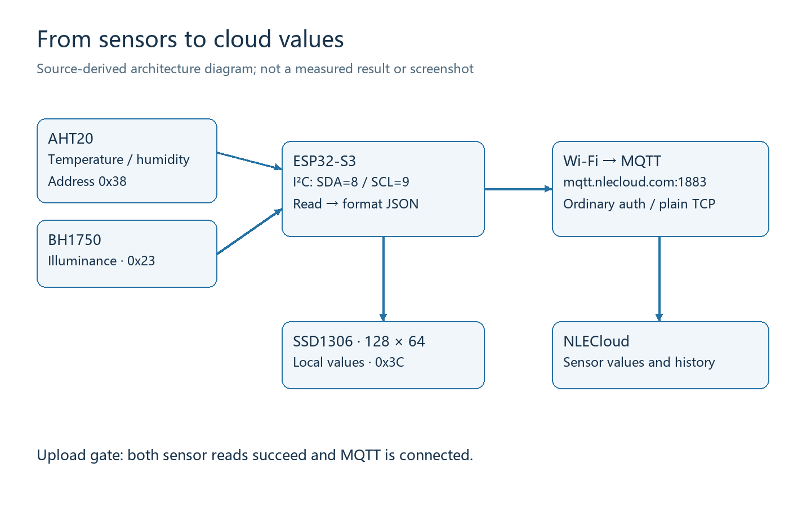
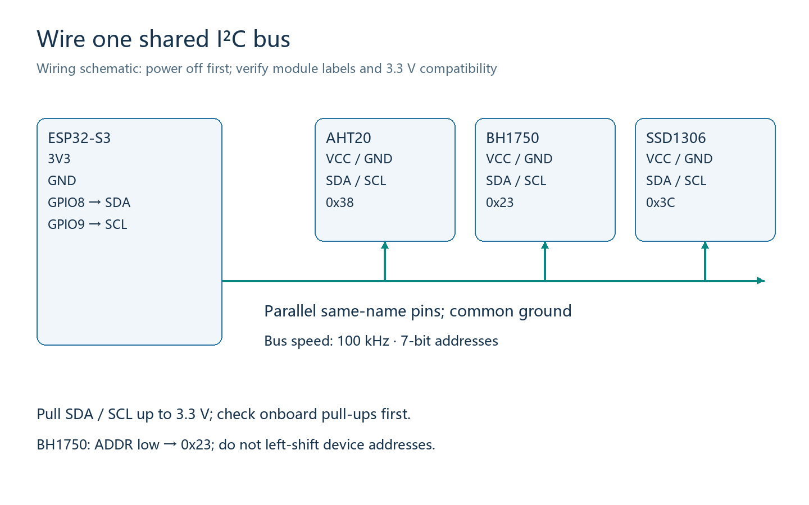
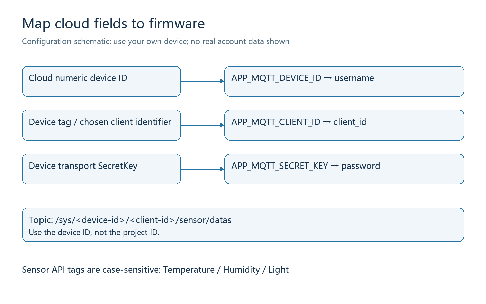
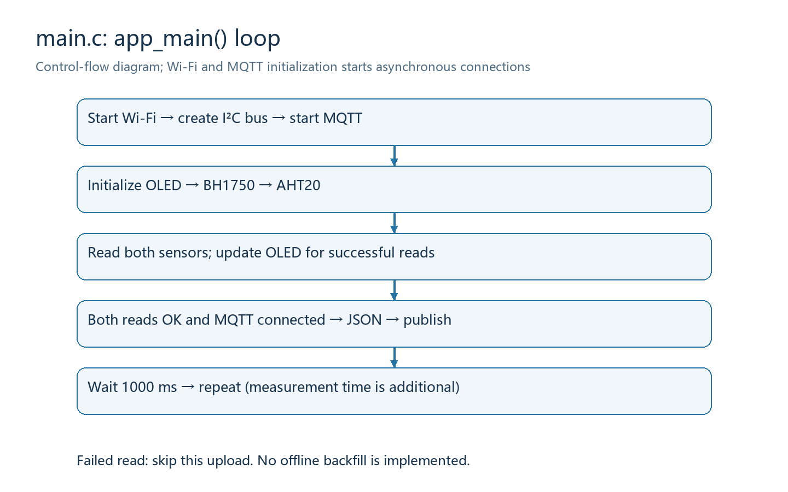

# ESP32-S3 environmental monitoring: from wiring to NLECloud

[中文教程](README_CN.md) · [Validation](docs/VALIDATION.md) · [Credential safety](SECURITY.md) · [Third-party notices](docs/THIRD_PARTY.md)

Build an environmental monitor with an **AHT20 temperature/humidity sensor**, a
**BH1750 light sensor**, and a **128×64 SSD1306 OLED**. Read the sensors over I²C,
display the readings locally, and publish them over Wi-Fi/MQTT to Newland's
NLECloud platform. This tutorial explains the wiring, build environment, cloud
configuration, firmware structure, observable results, and troubleshooting.

This directory is an independent publication copy of an existing project. The
author reports that the original system already connects and displays cloud
data. Publication-time build/static checks and hardware acceptance are separate;
see [the validation record](docs/VALIDATION.md). All illustrations below are
source-derived diagrams, not cloud screenshots or photographs of tested hardware.



## Learning path

Follow the steps in order and verify each layer before moving on:

1. Prepare the board, modules, tools, and network.
2. Wire the shared I²C bus with power disconnected.
3. Create your own cloud project, device, and three sensor fields.
4. Fill a private configuration file, build, and flash your board.
5. Compare serial readings, OLED values, and fresh cloud records.
6. Read the implementation and use the troubleshooting table when a layer fails.

Jump to [prerequisites](#1-hardware-and-development-environment),
[wiring](#2-wire-the-board-with-power-disconnected),
[cloud setup](#3-create-your-own-nlecloud-device),
[configuration](#4-download-and-configure-the-project),
[build and flash](#5-build-flash-and-observe),
[acceptance](#6-verify-the-complete-data-path),
[implementation](#7-understand-the-firmware), or
[troubleshooting](#8-troubleshooting).

## 1. Hardware and development environment

| Item | Required configuration | Purpose |
|---|---|---|
| ESP32-S3 development board | GPIO8 and GPIO9 available; Wi-Fi | Acquisition and networking |
| AHT20 module | I²C address `0x38` | Temperature and relative humidity |
| BH1750 module | ADDR low; I²C address `0x23` | Illuminance in lux |
| SSD1306 OLED | I²C, 128×64, address `0x3C` | Local display |
| Data-capable USB cable and jumper wires | Match your board and modules | Power, flashing, wiring |
| 2.4 GHz Wi-Fi network | Internet access and outbound MQTT allowed | Cloud connectivity |
| NLECloud account | Permission to create MQTT devices and sensors | Cloud storage/display |
| Windows PowerShell and Git | Command-line tools | Download and build |
| **ESP-IDF v6.1** | Component Manager identifies it as `6.1.0` | Verified SDK baseline |

The firmware target is **ESP32-S3**. Do not substitute another ESP32 family member
and assume the same pins and configuration apply. No exact board SKU or board
schematic was supplied. Check your board's pin availability and onboard peripheral
assignments before using GPIO8/GPIO9.

ESP-IDF is Espressif's development framework, including the compiler, build tools,
and chip drivers. If it is not installed, follow the
[official ESP32-S3 getting-started guide](https://docs.espressif.com/projects/esp-idf/en/release-v6.1/esp32s3/get-started/index.html)
and select v6.1. Installing ordinary Python alone does not provide the IDF toolchain.

Open the **ESP-IDF PowerShell** installed with your tools, then run:

```powershell
idf.py --version
git --version
```

The first command should report `ESP-IDF v6.1`. If `idf.py` is not found, activate
the installed IDF environment. On the machine used for this package, the command
below loads it; replace the path if your installation differs:

```powershell
# Use only if this file exists; otherwise use your installer's IDF terminal.
. C:\Espressif\tools\Microsoft.v6.1.PowerShell_profile.ps1
```

The external components are pinned to `espressif/mqtt 1.1.0` and
`k0i05/esp_type_utils 1.2.7`. `main/idf_component.yml` declares them, and
`dependencies.lock` records resolution. Component Manager downloads them during
the first build. You do not need to copy the entire `esp-idf-lib` collection or an
older I²C driver library into this project.

## 2. Wire the board with power disconnected

I²C is a shared bus. **SDA** carries data and **SCL** carries the clock. Devices
share those two lines and are selected by their addresses. All three modules here
have different addresses, so they use one bus instead of separate pin pairs.



| ESP32-S3 pin | AHT20 | BH1750 | SSD1306 OLED |
|---|---|---|---|
| 3V3 | VCC/VIN, verify 3.3 V compatibility | VCC/VIN, verify 3.3 V compatibility | VCC/VIN, verify 3.3 V compatibility |
| GND | GND | GND | GND |
| GPIO8 | SDA | SDA | SDA |
| GPIO9 | SCL | SCL | SCL |
| GND, as required by module design | — | ADDR low for `0x23` | — |

Disconnect power, connect ground and supply, connect SDA/SCL, check for shorts
and reversed power, and only then reconnect USB. Module pin order varies between
vendors: follow the printed labels and module schematic, not left-to-right order
in a generic photograph.

The bus runs at **100 kHz**. Addresses are **7-bit** values: AHT20 `0x38`, BH1750
`0x23`, OLED `0x3C`. Do not left-shift them. A BH1750 with ADDR high uses `0x5C`;
if that matches your hardware, set `config.i2c_address` in `main/main.c` accordingly
and rebuild.

Use 3.3 V signal levels. Internal pull-ups are enabled in the source, but they do
not replace properly selected external pull-ups for long wires or a heavily
loaded bus. Check whether your modules already contain pull-ups and where they
connect. Avoid accidentally combining several pull-up networks into an excessive
load, or pulling a signal up to 5 V.

Successful wiring is demonstrated by stable sensor readings and a working OLED
after boot. The source includes a `bsp_i2c_probe()` helper, but `app_main()` does
not call it: the default program does not automatically print an address scan.

## 3. Create your own NLECloud device

Use your own account and test device. Never reuse the author's device ID, tag,
or SecretKey. This section follows the
[official quick start](https://www.nlecloud.com/doc/quickstart.shtml) and
[device-access documentation](https://www.nlecloud.com/doc/devicedev/).
Exact menu labels may change; follow the current interface available to your account.

### 3.1 Create a project and device

1. Sign in to [NLECloud](https://www.nlecloud.com/) and enter the developer center.
2. Create a project using MQTT access. Give it a recognizable name and description.
3. Add a device to that project. Privately record its **numeric device ID**,
   **device tag**, and **device transport SecretKey**. The SecretKey is not your
   account login password.
4. Use a unique identifier for the device. This project uses its device tag as
   the MQTT Client ID. Two active clients using the same Client ID can disconnect
   one another; use another client identifier for a separate debugging tool.

**Project ID and device ID are different.** This implementation puts the device
ID in the MQTT username and Topic. It preserves the original **ordinary
authentication** flow: the password is the device SecretKey. It does not generate
a signed token. Do not mix token authentication instructions into this configuration.



### 3.2 Add three sensor fields

Under your device, add these numeric sensors. Display names can be localized;
the API tags must match exactly, including capitalization:

| Suggested display name | API tag | Unit | Firmware value |
|---|---|---|---|
| Temperature | `Temperature` | °C | AHT20 temperature |
| Relative humidity | `Humidity` | %RH | AHT20 r_humidity |
| Illuminance | `Light` | lux | BH1750 light_lux |

If the cloud tag is `temperature` while the firmware sends `Temperature`, a
successful connection may still produce no matching displayed value. A dashboard
widget alone does not create the corresponding device sensor field.

### 3.3 Understand the Topic and payload

MQTT is a publish/subscribe messaging protocol. The **broker** receives and routes
messages. The **Topic** is their path; the **payload** is their content. This
implementation publishes using:

```text
Broker: mqtt://mqtt.nlecloud.com:1883
Topic:  /sys/<device-id>/<client-id>/sensor/datas
QoS:    1
retain: 0
```

Replace the angle-bracket fields; do not include the brackets in actual values.
The code builds the Topic from `APP_MQTT_DEVICE_ID` and `APP_MQTT_CLIENT_ID`, so
you do not need to maintain a second hardcoded path.

```json
{
  "datatype": 1,
  "datas": {
    "Temperature": 25.50,
    "Humidity": 60.25,
    "Light": 123.00
  }
}
```

These are **illustrative numbers**, not measured results. `datatype: 1` selects
the API-tag-to-value object format. Values are JSON numbers, not quoted strings.
The firmware formats two decimal places; the OLED light reading is rounded to an
integer. The Topic layout preserves the existing project implementation. If
your tenant specifies another protocol contract, confirm it before changing code.

### 3.4 Inspect values and create a display page

First verify the sensor values and timestamps in the device detail/history view.
For a custom display, use your account's application designer or dashboard
feature, add three numeric/gauge widgets, bind each to this device's
`Temperature`, `Humidity`, and `Light`, set the units, and save/preview the page.
Feature availability depends on your account. This repository contains no cloud
dashboard export or ready-to-import page template: the firmware uploads values,
and you configure the page in your own account.

## 4. Download and configure the project

In Windows PowerShell, go to the directory where you keep projects and run:

```powershell
git clone https://github.com/1760hwy/esp32s3-nlecloud-environment-tutorial.git
cd esp32s3-nlecloud-environment-tutorial
Copy-Item main/app_secrets.example.h main/app_secrets.h
notepad main/app_secrets.h
```

If using GitHub's Download ZIP, extract it first and enter the directory containing
the top-level `CMakeLists.txt`. Do not build inside `main` or `docs`.

Fill the private file using this mapping:

| Macro | Your value | Common mistake |
|---|---|---|
| `APP_WIFI_SSID` | Your 2.4 GHz Wi-Fi name | Misspelled SSID or 5 GHz-only network |
| `APP_WIFI_PASSWORD` | Wi-Fi password | Cloud account password |
| `APP_MQTT_URI` | Supplied broker URI, or a verified endpoint | Website login URL |
| `APP_MQTT_DEVICE_ID` | Numeric cloud device ID, inside quotes | Project ID |
| `APP_MQTT_CLIENT_ID` | Your unique device identifier | Duplicate active identifier |
| `APP_MQTT_SECRET_KEY` | This device's transport SecretKey | Login password or unrelated API key |

This is a C header: keep string values in double quotes. Escape a backslash as
`\\` and a literal double quote as `\"`. Do not insert real values into
`app_secrets.example.h`. Check the ignore rules:

```powershell
git check-ignore main/app_secrets.h sdkconfig build/example.bin
git status --short
```

The first command should list all three paths. Your real configuration must not
appear in the second command's output. A missing private header produces an
actionable CMake error. Placeholder values can compile for a build-only check,
but cannot provide real Wi-Fi/cloud connectivity.

**Security boundary:** this inherited demo uses plain MQTT on port 1883. The
private header avoids committing credentials; it does not encrypt network traffic
or firmware. Use a dedicated test key. Never share real configuration, firmware,
or packet captures. Read [SECURITY.md](SECURITY.md) before publication.

## 5. Build, flash, and observe

### 5.1 Select the chip and build

Keep the IDF-enabled PowerShell working directory at the project root:

```powershell
idf.py set-target esp32s3
idf.py build
```

Run `set-target` on first setup or when changing targets; it regenerates build
configuration and is not needed before every build. `sdkconfig.defaults` selects
DIO Flash, 80 MHz Flash clock, a 2 MB Flash configuration, 160 MHz CPU, and a
100 Hz FreeRTOS tick. PSRAM is not enabled. The 2 MB setting is a project
configuration, not a measurement of your board's physical Flash capacity. Keep
the baseline for your first reproduction and check actual board specifications.

Successful compilation ends with `Project build complete` and generates
`build/nlecloud_environment.bin`, a bootloader, and a partition table. Dependency
downloads or successful CMake configuration alone are not a completed build.
The first dependency download needs network access; retain the pinned versions
rather than replacing them with `*`.

### 5.2 Identify the port and flash

Use Windows Device Manager to compare the available COM ports before and after
plugging in the board. Close software occupying the selected port. Replace
`COM7` below with your actual port:

```powershell
# Writes firmware and resets the selected board. Check the target first.
idf.py -p COM7 flash monitor
```

Back up any existing firmware/data you need before flashing. Exit an old monitor
before opening the same port again. Use **Ctrl+]** to leave IDF Monitor.
To inspect already-flashed firmware separately:

```powershell
idf.py -p COM7 monitor
```

### 5.3 Interpret the logs accurately

These are **keywords present in the source**, not a transcript captured from a
board during this publication:

| Keyword | What it demonstrates | What it does not demonstrate |
|---|---|---|
| `WiFi STA initialized` | Wi-Fi driver started | IP address acquired |
| `i2c_new_master_bus success` | I²C bus object created | All modules responding |
| `WiFi Got IP:` | IP event received | MQTT authentication accepted |
| `MQTT connected` | MQTT connected event received | Cloud sensor values updated |
| `Temperature:`, `Humidity:`, `Light:` | Corresponding acquisition succeeded | Cloud storage accepted data |
| `MQTT published, msg_id=` | Publish API returned a nonnegative message ID | Cloud business processing/page update completed |

Wi-Fi and MQTT connect asynchronously, so startup log order may vary. An early
`MQTT upload skipped/failed: ESP_ERR_INVALID_STATE` can occur before connection.
Check whether later samples upload after connection instead of treating that
single startup warning as a permanent failure.

## 6. Verify the complete data path

Do not stop at an online indicator. Verify each layer:

1. The OLED shows `Hello ESP32-S3`, then `TEMP`, `HUMI`, and `LIGHT` values.
2. Serial output shows plausible, continuously changing readings without
   persistent CRC/I²C failures.
3. Wi-Fi receives an IP address, MQTT connects, and publish calls keep returning.
4. Your cloud device shows all three sensor values with **fresh timestamps**;
   values broadly agree with serial output.
5. Shade the BH1750, then remove the shade. Confirm that serial, OLED, and cloud
   illuminance all change in the same direction. Avoid touching exposed circuits
   or introducing moisture onto the modules.
6. Briefly disconnect the test Wi-Fi and restore it. Observe reconnection, then
   verify **new** cloud records after recovery.

OLED light values are integers while serial/JSON values have two decimal places.
Sampling and network delays also create time differences. These alone do not
indicate failure. Start troubleshooting at the first layer that fails acceptance.

There is no application-level offline sample storage/backfill. Samples skipped
while disconnected are not uploaded later. The loop delays **1000 ms after**
measurement, display, and publishing. AHT20 includes at least an approximately
80 ms wait and BH1750 approximately 180 ms, plus communication and scheduling.
Consequently, this is not a precisely timed 1 Hz publisher.

## 7. Understand the firmware

### 7.1 Files to read first

```text
.
├── CMakeLists.txt              # IDF project entry
├── sdkconfig.defaults         # Public build defaults
├── dependencies.lock          # Resolved dependency versions
├── main/
│   ├── CMakeLists.txt          # Sources and include directories
│   ├── idf_component.yml      # External dependency declarations
│   ├── app_secrets.example.h  # Placeholder-only configuration template
│   ├── app_secrets.h          # You create this; ignored by Git
│   ├── main.c                 # app_main and sampling loop
│   └── BSP/
│       ├── i2c/               # Shared bus and optional address probe
│       ├── ath20/             # AHT20; original directory spelling
│       ├── bh1750/            # Light sensor driver
│       ├── ss1306/            # SSD1306; original directory spelling
│       └── network/           # Wi-Fi and MQTT
├── docs/                      # Figures, validation, provenance
├── tools/                     # Package checker and optional figure generator
├── LICENSES/                  # Supplied third-party licenses
├── README.md
└── README_CN.md
```

BSP means board support code: it separates hardware access from the application
flow. The original names `ath20` and `ss1306` are retained, but the actual devices
are AHT20 and SSD1306. Do not add another driver because of that spelling.

### 7.2 app_main connects the modules



Read [main.c](main/main.c). It starts Wi-Fi, creates the I²C bus, starts MQTT,
and initializes the display and sensors. Wi-Fi initialization returning does not
mean a connection has already been established. Each iteration reads AHT20 and
updates temperature/humidity, reads BH1750 and updates light, then calls the
following only if both reads succeeded:

```c
app_mqtt_publish_environment(
    aht20_data.temperature,
    aht20_data.r_humidity,
    light_lux
);
```

This avoids uploading a failed read as a fresh complete sample. The publishing
function also checks MQTT connection state. Offline calls return
`ESP_ERR_INVALID_STATE`; the main loop logs a warning and continues.

### 7.3 I²C: create the bus once

[bsp_i2c.c](main/BSP/i2c/bsp_i2c.c) creates the master bus using
`i2c_new_master_bus()`. `bsp_i2c_get_handle()` supplies the same handle, or driver
object reference, to all three drivers. Each device registers its own address.
Do not combine this master API with the old `i2c_driver_install()` API found in
reference libraries or create the same hardware bus repeatedly.

### 7.4 AHT20: wait, validate, then update the sample

[ath20.c](main/BSP/ath20/ath20.c) registers address `0x38`, resets the device,
and checks calibration in `AHT20_begin()`. `AHT20_measure()` sends
`0xAC 0x33 0x00`, waits, then polls the busy flag a bounded number of times.
The seven-byte response contains status, two 20-bit raw values, and a CRC.
A CRC is an error-detection checksum: a failed check must not be treated as a
valid reading.

```text
relative humidity = humidity_raw / 2^20 * 100
temperature       = temperature_raw / 2^20 * 200 - 50
```

The result structure is updated only after status, CRC, and range checks pass.
On error the previous successful values remain, but the main loop skips this
upload based on the error code. This is a single-device driver intended for
serialized calls, not a general concurrent multi-device implementation.

### 7.5 BH1750: convert the raw value into lux

[zh_bh1750.c](main/BSP/bh1750/zh_bh1750.c) sends the one-time high-resolution
command `0x20`, waits approximately 180 ms, reads two bytes, and calculates
`lux = raw / 1.2`. The read API takes the address of the handle, so the caller
passes `&bh1750`. Lux measures illuminance, not a percentage of camera brightness.

### 7.6 OLED: write ASCII text on display pages

[ssd1306.c](main/BSP/ss1306/ssd1306.c) drives the 128×64 display. The main loop
uses page indices 0, 2, 4, and 6 for title, temperature, humidity, and light.
Its 17-byte line buffer holds up to 16 ASCII characters plus the string terminator.
Changing a string to Chinese does not automatically add Chinese glyph support.

### 7.7 Wi-Fi and MQTT: events advance connection state

[app_wifi.c](main/BSP/network/app_wifi.c) initializes NVS, the network stack,
and the event loop, then starts STA mode: the ESP32 connects to an access point.
The disconnect event requests another connection. Wi-Fi configuration uses RAM
storage; the configuration strings still exist in the compiled firmware.

[app_mqtt.c](main/BSP/network/app_mqtt.c) initializes the client, registers
events, and updates a connection flag on CONNECTED/DISCONNECTED events.
`snprintf()` formats a 192-byte JSON buffer and checks for truncation.
`esp_mqtt_client_publish()` uses QoS 1 and retain 0. QoS 1 permits duplicate
delivery; it is not exactly-once cloud business storage. This code does not
subscribe to commands, parse cloud responses, or use PUBACK/business responses
to establish end-to-end acceptance.

### 7.8 Existing engineering limitations

This package preserves the existing application rather than adding unrelated
firmware changes. Keep these limitations in mind:

- After OLED initialization fails, later display calls may still be attempted;
  their return values are not fully handled. Verify the display connection first.
- BH1750/AHT20 initialization uses `ESP_ERROR_CHECK`; a failure can cause a panic
  and reboot.
- NVS initialization errors are returned without automatic partition erase or
  recovery. Do not erase all Flash as a first troubleshooting step.
- Offline backfill, precise periodic scheduling, provisioning, TLS/token
  authentication, and long-term reliability acceptance are not implemented or
  verified by this publication.

## 8. Troubleshooting

| Symptom | Check first | Evidence of recovery |
|---|---|---|
| `idf.py` not found | Use the v6.1 IDF terminal | Correct version output |
| CMake asks for `app_secrets.h` | Private header missing | Copy and fill the template |
| Dependency download fails | Network, registry, proxy configuration | Pinned components resolve during build |
| I²C API not found during build | Wrong SDK or mixed legacy drivers | v6.1 build with this driver set |
| Port missing/busy | Data cable, driver, COM selection, other monitors | Flasher identifies ESP32-S3 |
| I²C NACK / NOT_FOUND | Supply, common ground, SDA/SCL, address, pull-ups | Stable repeated readings |
| BH1750 initialization fails | ADDR might select `0x5C`; wiring | Valid lux readings after correction |
| AHT20 CRC/timeout | Stable supply, short bus, module model | Repeated valid temperature/humidity samples |
| OLED blank | SSD1306, I²C, 128×64, address `0x3C` | Title and all three values visible |
| Wi-Fi keeps reconnecting | SSID, password, 2.4 GHz, access policy | `WiFi Got IP:` |
| MQTT fails to connect | Device ID/key, endpoint, duplicate Client ID | Stable `MQTT connected` state |
| MQTT connects but cloud values do not change | Topic, case-sensitive tags, both sensor reads | Fresh timestamps on all three values |
| Temperature/humidity update locally, no upload | BH1750 read failure gates the entire upload | Both sensor reads pass |
| History gap after outage | No application sample backfill exists | New records after reconnection |

Do not disable TLS verification to bypass certificate failures. This baseline
uses plain MQTT. A later MQTTS upgrade needs a verified root certificate, time
handling, and a separate connectivity/acceptance test.

## 9. Reproduction and publication checklist

- [ ] ESP32-S3 and ESP-IDF v6.1; component versions match the lockfile.
- [ ] Power-off wiring check: GPIO8/9, 3.3 V, common ground, addresses, pull-ups.
- [ ] Your cloud device contains `Temperature`, `Humidity`, and `Light`.
- [ ] Real values exist only in `app_secrets.h`; examples/figures contain no credentials.
- [ ] `idf.py build` completes; you identify your target board before flashing.
- [ ] Serial, OLED, and fresh cloud values pass the shading test.
- [ ] Run `python tools/check_package.py` and manually inspect staged files.
- [ ] Exclude real configuration, credential-bearing firmware, captures, and the parent workspace.

Figures are supplied as PNG and editable SVG. Optional regeneration:
`python tools/render_figures.py` requires Pillow and a Chinese-capable font;
Pillow is not required to read the tutorial or compile the firmware.

Project-specific behavior is grounded in this repository's source. Official
references above support setup and cloud concepts. See
[THIRD_PARTY.md](docs/THIRD_PARTY.md) for supplied licenses and unresolved license
provenance; this repository does not assign a blanket open-source license.
