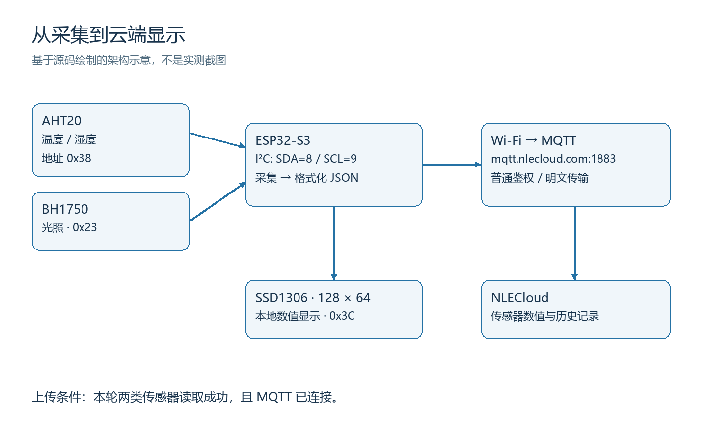
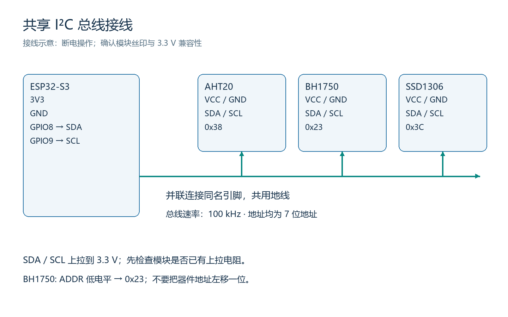
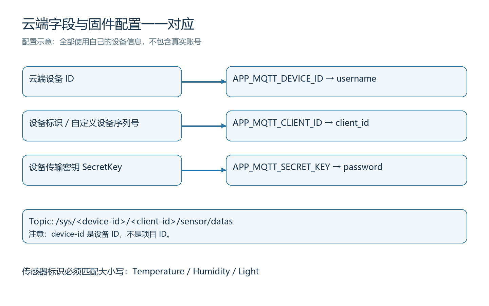
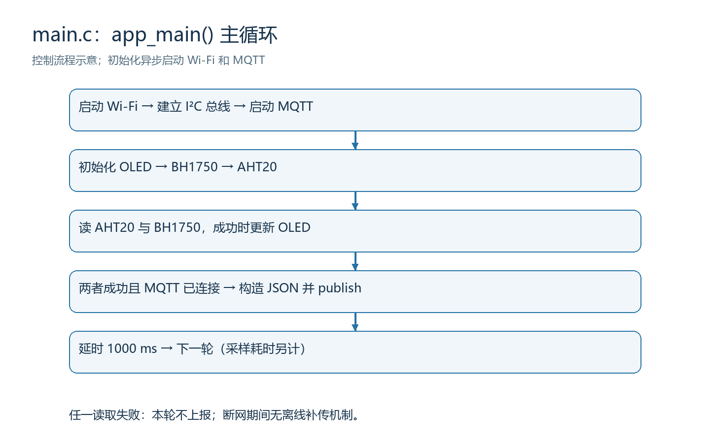

# 从零实现 ESP32-S3 环境监测、OLED 显示与新大陆云上报

[English](README.md) · [验证记录](docs/VALIDATION.md) · [凭据保护](SECURITY.md) · [第三方来源](docs/THIRD_PARTY.md)

这是一份面向初学者的完整工程教程：使用 AHT20 测量温度和湿度，使用 BH1750
测量光照，在 SSD1306 OLED 上显示，并通过 Wi-Fi 和 MQTT 将数值上传到新大陆
物联网云平台（NLECloud）。你会同时学到接线、ESP-IDF 构建、模块调用、
JSON 数据组织、云端字段映射和分层排错。

本目录是原有工程的独立发布副本，包含源码、依赖版本和教学插图；原有工程未被替换。
作者报告原工程已实现联网上云显示。本次整理的验证以
[验证记录](docs/VALIDATION.md) 为准：重新构建与静态检查不等于再次完成实物上云验收。
教程中的图是依据代码绘制的示意图，不是实际云平台截图或实物照片。



## 阅读路线与学习目标

建议按顺序完成，每一步先确认现象，再进入下一步。

1. 准备开发板、传感器与软件，理解整条数据链。
2. 断电接好 I²C 总线，核对地址和供电。
3. 创建自己的云项目、设备和三个传感器。
4. 配置自己的账号信息，构建、烧录和观察串口。
5. 对照 OLED、串口和云端最新时间，完成完整验收。
6. 回看代码，理解为什么这样调用，以及出错时从哪里查。

目录导航：[准备材料](#1-准备材料与开发环境) · [接线](#2-断电接线) ·
[云端配置](#3-创建自己的新大陆云设备) · [下载配置](#4-下载工程与填写本地配置) ·
[构建烧录](#5-构建烧录与串口观察) · [验收](#6-确认云端真正收到了数据) ·
[代码讲解](#7-沿着代码理解实现) · [排错](#8-常见问题与排查顺序)

## 1. 准备材料与开发环境

| 材料 | 本工程要求 | 为什么需要 |
|---|---|---|
| ESP32-S3 开发板 | 引出 GPIO8、GPIO9，具备 Wi-Fi | 主控、采集与联网 |
| AHT20 模块 | I²C 地址 `0x38` | 温度、相对湿度 |
| BH1750 模块 | ADDR 低电平，地址 `0x23` | 照度，单位 lux |
| SSD1306 OLED | I²C、128×64、地址 `0x3C` | 本地字符显示 |
| 数据 USB 线、连接线 | USB 线须支持数据传输 | 供电、烧录和监视 |
| 2.4 GHz Wi-Fi | 能访问互联网与 MQTT 端口 | ESP32-S3 联网 |
| 新大陆云账号 | 可创建 MQTT 设备及传感器 | 接收和查看数据 |
| Windows PowerShell、Git | 命令行操作 | 下载和构建 |
| ESP-IDF **v6.1** | 对应 Component Manager 中的 `6.1.0` | 本次实际使用的 SDK |

这里的 ESP32-S3 是源码与锁文件的目标，不能直接换成 ESP32-P4 或普通 ESP32
后照搬 GPIO 和配置。开发板的具体型号、板载外设占用和模块引脚顺序没有随工程提供，
请以自己的板卡原理图为准。若 GPIO8/9 已被板载外设使用，应先解决引脚冲突。

ESP-IDF 是 Espressif 官方开发框架，包含编译器、构建工具和芯片驱动。
如果尚未安装，按 [ESP32-S3 官方入门说明](https://docs.espressif.com/projects/esp-idf/en/release-v6.1/esp32s3/get-started/index.html)
完成 Windows 环境安装，选择 v6.1；不要只安装普通 Python 后直接运行 `idf.py`。

打开安装器提供的 **ESP-IDF PowerShell**，运行：

```powershell
idf.py --version
git --version
```

第一条应报告 `ESP-IDF v6.1`。若提示找不到 `idf.py`，说明当前终端尚未加载
ESP-IDF 环境。在本文整理机器上，加载脚本为下面这个路径；你的安装位置可能不同：

```powershell
# 仅当此文件确实存在时执行；否则使用安装器提供的终端。
. C:\Espressif\tools\Microsoft.v6.1.PowerShell_profile.ps1
```

本工程锁定的外部组件为 `espressif/mqtt 1.1.0` 和
`k0i05/esp_type_utils 1.2.7`，由 `main/idf_component.yml` 声明。
首次构建由 Component Manager 下载，`dependencies.lock` 记录解析结果。
无需另外复制整套 `esp-idf-lib` 或旧式 I²C 库。

## 2. 断电接线

I²C 是一条可挂多个器件的总线。SDA 传数据，SCL 提供时钟；每个器件用地址区分。
这里三个器件地址不同，因此共用 GPIO8、GPIO9，而不是给每个模块各占一对引脚。



| ESP32-S3 引脚 | AHT20 | BH1750 | SSD1306 OLED |
|---|---|---|---|
| 3V3 | VCC/VIN（确认兼容 3.3 V） | VCC/VIN（确认兼容 3.3 V） | VCC/VIN（确认兼容 3.3 V） |
| GND | GND | GND | GND |
| GPIO8 | SDA | SDA | SDA |
| GPIO9 | SCL | SCL | SCL |
| GND（按模块设计） | — | ADDR：保持低电平以选 `0x23` | — |

操作顺序：拔掉供电 → 对照各模块丝印接电源与地 → 接 SDA/SCL → 检查没有短路
和电源反接 → 再接 USB。不同厂家的四针模块引脚顺序可能不同，不要只按图片左右位置接。

本工程总线使用 100 kHz、7 位地址。AHT20=`0x38`、BH1750=`0x23`、
OLED=`0x3C`。不要把地址左移一位。BH1750 的 ADDR 为高电平时地址变成 `0x5C`，
对应修改 `main/main.c` 中的 `config.i2c_address` 后重新构建。

GPIO 信号电平按 3.3 V 处理。源码启用了内部上拉，但长线或较大负载下不能把它
当成可靠外部上拉的替代品。先确认模块板上是否已有上拉、上拉接到什么电压；需要时
再按总线电容与模块要求配置外部上拉，避免多组并联导致上拉过强。

接线成功的实际证据应是设备启动后传感器稳定读数、OLED 正常显示。
`bsp_i2c_probe()` 只是项目提供的辅助探测函数，当前 `app_main()` 没有调用它，
因此不能指望默认启动日志会自动列出所有器件地址。

## 3. 创建自己的新大陆云设备

云端配置必须使用自己的账号和测试设备，不能沿用作者的设备 ID、标识或密钥。
本节根据 [官方快速入门](https://www.nlecloud.com/doc/quickstart.shtml) 与
[官方设备接入说明](https://www.nlecloud.com/doc/devicedev/) 编写；
菜单名称可能随平台界面变化，以当前账号界面为准。

### 3.1 先建项目，再建设备

1. 登录 [新大陆物联网云平台](https://www.nlecloud.com/)，进入开发者中心。
2. 新建项目，选择 MQTT 接入方式，填写便于识别的名称和说明。
3. 在项目下新增设备。记录平台分配的**设备 ID**、自己的**设备标识**和
   **设备传输密钥 SecretKey**。不要把登录密码当作设备密钥。
4. 保持设备标识唯一；本工程将它用作 MQTT Client ID。同一个 Client ID 被多个
   客户端同时使用，可能造成互相挤下线。调试工具应使用不同客户端标识。

**项目 ID 和设备 ID 是不同概念。** 本工程 MQTT 的 username 和 Topic 中使用设备 ID。
这里保留原工程的普通鉴权模式：password 使用设备传输密钥，不生成 token。
官方还提供安全鉴权；不能混用普通鉴权的配置与 token 参数。



### 3.2 定义三个传感器

在刚创建的设备中分别新增三个数值型传感器。名称可用中文，但 API 标识必须与下表一致：

| 显示名称建议 | API 标识（区分大小写） | 数值单位 | 固件来源 |
|---|---|---|---|
| 温度 | `Temperature` | °C | AHT20 temperature |
| 相对湿度 | `Humidity` | %RH | AHT20 r_humidity |
| 光照 | `Light` | lux | BH1750 light_lux |

例如你把 API 标识写成 `temperature`，但固件上传 `Temperature`，就可能连接成功却
看不到对应数值。不要把中文显示名称直接填成 API 标识，也不要只创建一块仪表但忘记传感器。

### 3.3 理解 Topic 和 JSON

MQTT 是发布/订阅消息协议。Broker 是接收并转发消息的服务器，Topic 是消息路径，
payload 是实际内容。本工程向下面的路径发布：

```text
服务器：mqtt://mqtt.nlecloud.com:1883
Topic：/sys/<设备ID>/<Client ID>/sensor/datas
QoS：1
retain：0
```

这里的尖括号表示需要替换的字段，不应保留在实际字符串中。
固件根据 `APP_MQTT_DEVICE_ID` 与 `APP_MQTT_CLIENT_ID` 自动拼接 Topic，
不用在另一个文件再填一遍。

```json
{
  "datatype": 1,
  "datas": {
    "Temperature": 25.50,
    "Humidity": 60.25,
    "Light": 123.00
  }
}
```

以上数字只是**讲解格式的示例值**。`datatype: 1` 表示 `datas` 内按 API 标识映射数值；
数值没有包在引号中。当前格式化保留两位小数，OLED 的光照显示则四舍五入为整数。
Topic 路径是原工程保留的实现约定；若你所在租户给出不同的协议要求，应先核对而非盲改。

### 3.4 查看数值与制作展示页面

先使用设备详情中的传感器实时值/历史记录完成验收，这是最直接的数据证据。
需要自定义大屏时，再在平台提供的应用设计器或展示功能中添加三个数值/仪表组件，
分别绑定当前设备的 `Temperature`、`Humidity`、`Light`，设置单位后保存预览。
平台账号是否提供该功能取决于实际权限；本仓库不包含云端页面导出文件，
也没有一套可直接导入的大屏模板。固件负责上传，页面布局需要在自己的账号内建立。

## 4. 下载工程与填写本地配置

以下命令使用 Windows PowerShell。先进入自己准备存放源码的目录，再执行：

```powershell
git clone https://github.com/1760hwy/esp32s3-nlecloud-environment-tutorial.git
cd esp32s3-nlecloud-environment-tutorial
Copy-Item main/app_secrets.example.h main/app_secrets.h
notepad main/app_secrets.h
```

如果用 GitHub 的 Download ZIP 下载，先解压，再进入含顶层 `CMakeLists.txt` 的目录。
不要进入 `main` 或 `docs` 构建。

在 `main/app_secrets.h` 中填写：

| 配置宏 | 应填写内容 | 常见误填 |
|---|---|---|
| `APP_WIFI_SSID` | 你的 2.4 GHz Wi-Fi 名称 | 名称拼错，或只有 5 GHz |
| `APP_WIFI_PASSWORD` | Wi-Fi 密码 | 错填云端密码 |
| `APP_MQTT_URI` | 保留原示例地址，或经核实的服务器地址 | 使用网页登录 URL |
| `APP_MQTT_DEVICE_ID` | 云端设备 ID，放在双引号中 | 填项目 ID |
| `APP_MQTT_CLIENT_ID` | 你为设备使用的唯一标识 | 多块板使用相同标识 |
| `APP_MQTT_SECRET_KEY` | 此设备的传输密钥 | 填登录密码/第三方 API key |

这是 C 头文件，宏值必须保留双引号；密码中的反斜杠写成 `\\`，双引号写成 `\"`。
不要把真实配置填进 `app_secrets.example.h`。检查忽略规则：

```powershell
git check-ignore main/app_secrets.h sdkconfig build/example.bin
git status --short
```

第一条应列出这三个路径；第二条不应出现真实配置文件。
如果尚未复制本地头文件，CMake 会主动报错并给出复制提示。
模板占位符可以用于仅构建检查，但不提供真实连接能力。

**凭据保护的边界：** 当前 demo 使用 1883 明文 MQTT，凭据会通过网络传输并存在固件中。
`.gitignore` 只减少误提交，不能加密通信或固件。使用专用测试密钥，不发布真实配置、
固件或抓包。详见 [SECURITY.md](SECURITY.md)。

## 5. 构建、烧录与串口观察

### 5.1 设置目标并构建

在已经加载 ESP-IDF 的 PowerShell 中，工作目录保持在本工程根目录：

```powershell
idf.py set-target esp32s3
idf.py build
```

`set-target` 用于首次设置芯片，并会重新生成构建配置，不需要每次编译都执行。
`sdkconfig.defaults` 提供 DIO、80 MHz Flash、2 MB 分区预算、160 MHz CPU
和 100 Hz FreeRTOS tick 的默认值，不启用 PSRAM。这里的 2 MB 是工程构建配置，
不是对你开发板物理容量的测量。首次复现建议先保留基线；其他板卡应核对硬件规格。

成功应看到 `Project build complete`，并生成 `build/nlecloud_environment.bin`、
bootloader 和分区表。只看到 CMake 配置完成或依赖下载完成不代表编译已通过。
首次下载组件需要网络；不要把锁文件中的精确版本随意改成 `*`。

### 5.2 找到串口并烧录

用 Windows 设备管理器观察插拔开发板前后的“端口”变化，确认自己的 COM 号。
先关闭占用该串口的软件，然后将下面的 `COM7` 替换为实际端口：

```powershell
# 此命令会写入并重启开发板；确认选中了自己的目标板。
idf.py -p COM7 flash monitor
```

如果你有需要保留的现有固件/数据，应先完成备份再烧录。
终端占用时先退出旧监视器。监视器退出快捷键是 `Ctrl+]`。
单独观察已经烧录的程序可运行：

```powershell
idf.py -p COM7 monitor
```

### 5.3 用真实日志逐层判断

下面列出的是代码中的日志关键字，**不是本次设备实测日志**：

| 关键字 | 表示什么 | 还不能证明什么 |
|---|---|---|
| `WiFi STA initialized` | Wi-Fi 驱动启动完成 | 已获得 IP |
| `i2c_new_master_bus success` | I²C 总线对象创建成功 | 三个外设都已响应 |
| `WiFi Got IP:` | 收到获取 IP 的事件 | MQTT 鉴权成功 |
| `MQTT connected` | MQTT 连接事件到达 | 传感器数据已显示在云端 |
| `Temperature:`、`Humidity:`、`Light:` | 本轮对应采集成功并打印数值 | 云端已保存 |
| `MQTT published, msg_id=` | 发布 API 返回非负消息 ID | 云端业务处理和页面更新成功 |

Wi-Fi/MQTT 由事件驱动异步连接，因此启动日志次序不一定固定。
初次连接尚未完成时可能出现 `MQTT upload skipped/failed: ESP_ERR_INVALID_STATE`，
应看后续是否连接并恢复上传，而不是只截取启动瞬间判断失败。

## 6. 确认云端真正收到了数据

按下面的顺序验收，避免看到“在线”就结束：

1. OLED 顶部出现 `Hello ESP32-S3`，其后显示 `TEMP`、`HUMI`、`LIGHT`。
2. 串口连续输出合理的温度、湿度、照度，且没有持续 CRC/I²C 报错。
3. 串口获得 IP 并报告 MQTT 已连接，持续出现 publish 返回信息。
4. 在自己的云端设备中查看三个传感器，确认最新时间更新，数值与串口大致对应。
5. 遮挡 BH1750，再移开遮挡，观察串口、OLED 与云端照度是否同方向变化。
   不要用手接触裸露电路，也不要把呼气冷凝水吹到模块上。
6. 短暂断开测试 Wi-Fi 后恢复，观察网络与 MQTT 是否重新连接，再确认**新的**云端记录。

OLED 光照为整数，串口与 JSON 为两位小数；异步采样和网络延迟也会造成显示时间差。
这些不同不能单独作为失败依据。失败时从最早没有通过的一层开始排查。

项目没有存储并补传断网数据的代码。断网期间跳过的样本，不会在恢复后自动补齐。
当前循环在测量、显示、发布之后才延时 1000 ms：AHT20 至少等待约 80 ms，
BH1750 等待约 180 ms，还要加通信和调度时间。因此不能将其描述成精确的 1 Hz 上报。

## 7. 沿着代码理解实现

### 7.1 工程结构：先看哪些文件

```text
.
├── CMakeLists.txt              # ESP-IDF 工程入口
├── sdkconfig.defaults         # 可公开的构建默认配置
├── dependencies.lock          # 锁定外部依赖
├── main/
│   ├── CMakeLists.txt          # 编译源文件与 include 路径
│   ├── idf_component.yml      # 外部组件版本声明
│   ├── app_secrets.example.h  # 无真实凭据的配置模板
│   ├── app_secrets.h          # 自己创建，被 Git 忽略
│   ├── main.c                 # app_main 与采样主循环
│   └── BSP/
│       ├── i2c/               # 共用总线与可选地址探测
│       ├── ath20/             # AHT20；保留原目录拼写
│       ├── bh1750/            # BH1750 驱动
│       ├── ss1306/            # SSD1306；保留原目录拼写
│       └── network/           # Wi-Fi 与 MQTT
├── docs/                      # 插图、验证记录与来源
├── tools/                     # 发布检查与可选配图生成
├── LICENSES/                  # 已有第三方许可证
├── README.md
└── README_CN.md
```

`BSP` 指板级支持代码，用来把硬件操作与业务流程分开。`ath20`、`ss1306` 是原工程
目录名，实际器件仍为 AHT20、SSD1306。不要因为目录拼写不同又引入另一份驱动。

### 7.2 app_main：把模块串起来



阅读 [main.c](main/main.c)：先启动 Wi-Fi，再创建 I²C 总线、启动 MQTT，
然后初始化三个外设。Wi-Fi 初始化返回代表驱动启动，不代表此时已经联网。
主循环读 AHT20、更新温湿度显示，再读 BH1750、更新光照；两次读取都成功才调用：

```c
app_mqtt_publish_environment(
    aht20_data.temperature,
    aht20_data.r_humidity,
    light_lux
);
```

这样可避免将本轮失败的传感器值当成全新数据上传。发布函数还会检查 MQTT 状态；
离线时返回 `ESP_ERR_INVALID_STATE`，主循环只打印警告并继续。

### 7.3 I²C：总线只建一次

[bsp_i2c.c](main/BSP/i2c/bsp_i2c.c) 调用 `i2c_new_master_bus()` 建立主机总线，
`bsp_i2c_get_handle()` 将同一个 handle 交给三个驱动。handle 可理解为驱动对象的引用。
每个器件再用自己的地址向总线登记。这是 ESP-IDF 当前 I²C master API 的用法；
不要混入参考库里的旧式 `i2c_driver_install()`，也不要重复创建同一个硬件端口。

### 7.4 AHT20：等待测量、检查 CRC、再更新样本

[ath20.c](main/BSP/ath20/ath20.c) 的 `AHT20_begin()` 添加 `0x38` 器件、
复位并检查校准状态。`AHT20_measure()` 发出 `0xAC 0x33 0x00` 测量命令，
先等待，再有限次轮询 busy 位。读取的 7 字节中包括状态、两个 20 位原始量和 CRC。
CRC 是用于检测传输数据错误的校验码；校验失败时不能继续把数据当作正常值。

```text
相对湿度 = humidity_raw / 2^20 × 100
温度     = temperature_raw / 2^20 × 200 - 50
```

只有状态、CRC 和范围检查都通过才写入结果结构体；失败时保留上次成功值，但主循环
会根据返回码跳过本轮上报。驱动按单设备、单任务使用设计，不是通用多设备并发驱动。

### 7.5 BH1750：从原始量到 lux

[zh_bh1750.c](main/BSP/bh1750/zh_bh1750.c) 使用一次高分辨率测量命令 `0x20`，
等待约 180 ms，读取两个字节，然后计算 `lux = raw / 1.2`。
`zh_bh1750_read()` 接收的是 handle 的地址，所以主循环传入 `&bh1750`。
这里的 lux 是照度，不是相机亮度百分比。

### 7.6 OLED：按页写 ASCII 字符

[ssd1306.c](main/BSP/ss1306/ssd1306.c) 驱动 128×64 OLED。
当前主循环使用页号 0、2、4、6 显示标题、温度、湿度和光照。
每行缓冲区 17 字节，对应最多 16 个 ASCII 字符加字符串终止符。
当前用英文标签，不能直接把字符串改成中文就期待正确显示中文字体。

### 7.7 Wi-Fi 与 MQTT：由事件推进连接状态

[app_wifi.c](main/BSP/network/app_wifi.c) 初始化 NVS、TCP/IP 网络接口和事件循环，
设置 STA（作为客户端连接路由器）模式，断线事件中请求重新连接。
Wi-Fi 凭据存储方式设置为 RAM；这不表示编译进固件的字符串不存在。

[app_mqtt.c](main/BSP/network/app_mqtt.c) 初始化客户端，注册事件处理函数，
在 CONNECTED/DISCONNECTED 事件中更新标志。
`snprintf()` 把浮点测量值格式化为 JSON，并检查 192 字节缓冲区是否溢出。
调用 `esp_mqtt_client_publish()` 时使用 QoS 1、retain 0。
QoS 1 的语义允许重复投递，不应被理解为云端业务恰好保存一次。
当前代码没有订阅下行命令、解析云端应答，也没有用 PUBACK/业务应答完成端到端确认。

### 7.8 保留的工程边界

为保持与原工程一致，本次没有借文档整理大幅重构固件。读者应了解这些已有局限：

- OLED 初始化失败后，主循环仍可能尝试显示；后续显示返回码没有完整处理。
  调试时先把屏幕接好，不能把屏幕空白与云端失败混为一谈。
- BH1750/AHT20 初始化使用 `ESP_ERROR_CHECK`，失败可能触发 panic 并重启。
- NVS 初始化错误会返回失败，没有自动擦除分区的恢复流程。
  不要未经备份就使用整片擦除来“修复”。
- 缺少离线缓存、严格周期调度、凭据配网、TLS/token 和长期可靠性验收。
  这些是后续工程化方向，不是此发布包已经完成的能力。

## 8. 常见问题与排查顺序

| 现象 | 优先检查 | 如何确认修复 |
|---|---|---|
| 找不到 `idf.py` | 是否打开 v6.1 的 ESP-IDF 终端 | `idf.py --version` 正确 |
| 提示复制 `app_secrets.h` | 本地私有头文件未创建 | 按第 4 节复制并配置 |
| 依赖下载失败 | 网络、组件注册表、代理配置 | 构建中列出锁定的组件版本 |
| 编译提示 I²C API 不存在 | SDK 版本或混入旧驱动 | 使用 v6.1 并保留此驱动集合 |
| 烧录找不到串口/被占用 | 数据线、驱动、实际 COM 号、旧监视器 | 烧录工具识别目标 ESP32-S3 |
| I²C NACK / NOT_FOUND | 供电、共地、SDA/SCL、7 位地址、上拉 | 连续读数稳定，不持续报错 |
| BH1750 初始化失败 | ADDR 是否选到 `0x5C`、接线是否接反 | 使用正确地址后读到 lux |
| AHT20 CRC/timeout | 电源稳定性、总线干扰、线长和器件型号 | 连续通过 CRC 并更新温湿度 |
| OLED 空白 | 是否 SSD1306/I²C/128×64/`0x3C` | 标题和三行读数正常 |
| Wi-Fi 一直重连 | SSID、密码、2.4 GHz、路由器权限 | 出现 `WiFi Got IP:` |
| MQTT 连接失败 | 设备 ID、设备密钥、端口、重复 Client ID | 出现 `MQTT connected` 并保持 |
| MQTT 已连接但数值不更新 | Topic、API 大小写、是否两类读取都成功 | 三个最新值的时间持续更新 |
| 只更新温湿度、不上报 | BH1750 读取是否失败 | 两类传感器均成功后恢复上报 |
| 断网后历史缺一段 | 当前没有缓存补传 | 恢复后验证新样本，不能期待补齐 |

不要为了绕过证书错误关闭 TLS 校验；此基线本来就使用明文 MQTT。
若后续升级 MQTTS，需要单独实现根证书、时间同步和验证，再做联网验收。

## 9. 复现与发布检查清单

- [ ] 使用 ESP32-S3 和 ESP-IDF v6.1，外部组件版本与锁文件一致。
- [ ] 已断电检查 GPIO8/9、3.3 V、共地、模块地址和上拉。
- [ ] 自己的云设备中存在 `Temperature`、`Humidity`、`Light`。
- [ ] 真实配置只在 `app_secrets.h`，模板和截图没有凭据。
- [ ] `idf.py build` 完成，明确烧录的是自己的目标板。
- [ ] 串口、OLED 和云端最新值均已检查，遮挡光照后可看到变化。
- [ ] 分享前运行 `python tools/check_package.py` 并人工检查暂存文件。
- [ ] 不分享含真实凭据的固件、构建目录、抓包或上级原工程。

配图已附 PNG 与可编辑 SVG；可选运行
`python tools/render_figures.py` 重新生成，需要 Pillow 和支持中文的字体。
普通构建与阅读不需要安装 Pillow。

来源与验收范围：项目实现以本仓库源码为准；环境与云配置参考上文官方文档。
第三方许可证和无法确认的授权边界见 [THIRD_PARTY.md](docs/THIRD_PARTY.md)，
不对全部代码擅自声明统一开源许可证。
